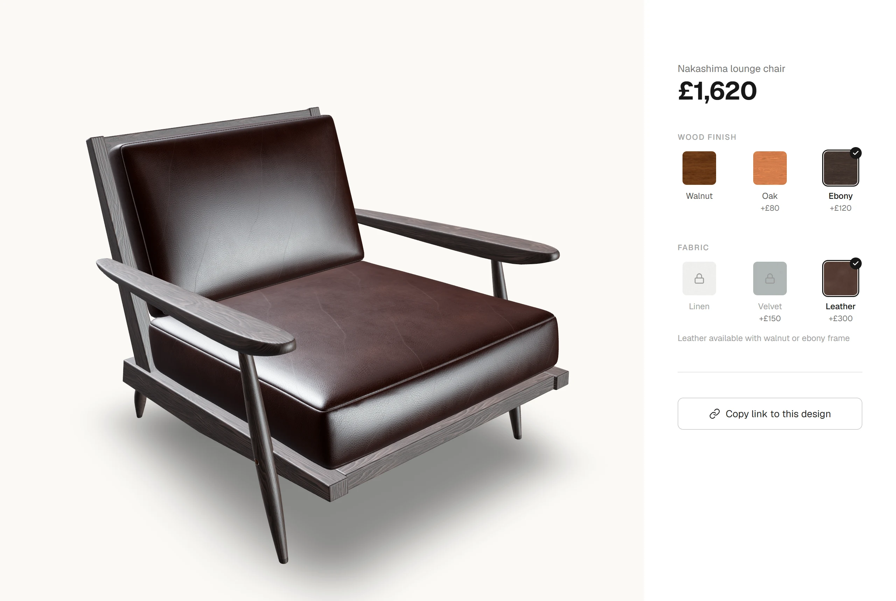
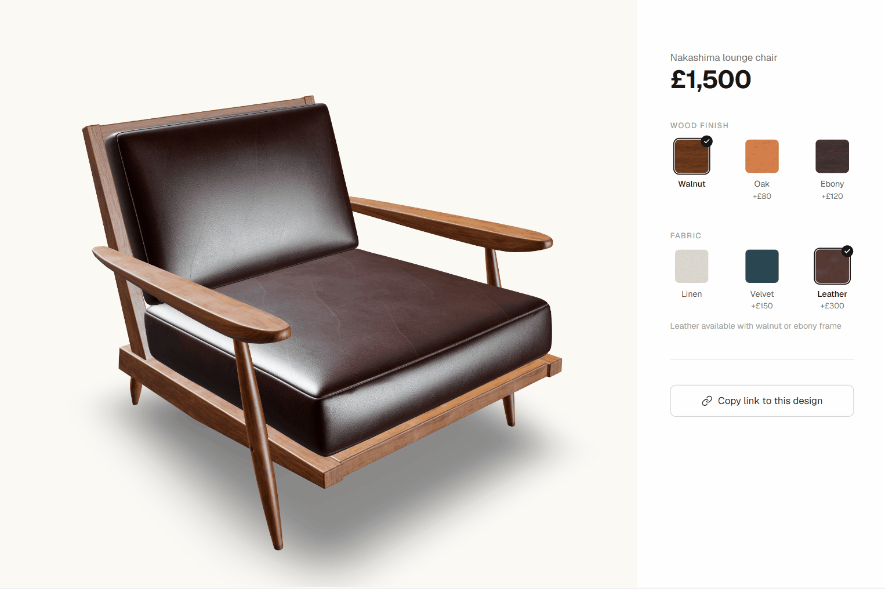

# Nakashima Lounge Chair — Configurator

A browser-based 3D product configurator. Choose a wood finish and a fabric, watch the price update, and share the exact configuration as a link.

**[Live demo →](https://nakashima-configurator.vercel.app/)**
**[A shared configuration →](https://nakashima-configurator.vercel.app/?wood=ebony&fabric=leather)** — ebony frame, leather cushion, restored from the URL





---

Most 3D product configurators are a static model with orbit controls — something a free embed or a low-cost SaaS plugin can do. This one is built around the parts they can't: **cross-option constraint logic, pricing derived from the selection, and configuration state that lives in the URL.**

It's a portfolio piece, not a shop. The chair isn't for sale; the engineering is the point.

---

## Contents

- [What it demonstrates](#what-it-demonstrates)
- [Correct-by-construction state](#correct-by-construction-state)
- [Derived pricing](#derived-pricing)
- [URL as the shareable state](#url-as-the-shareable-state)
- [Performance and the asset pipeline](#performance-and-the-asset-pipeline)
- [Materials](#materials)
- [Robustness](#robustness)
- [Responsive and accessible](#responsive-and-accessible)
- [Deliberately out of scope](#deliberately-out-of-scope)
- [Two bugs worth describing](#two-bugs-worth-describing)
- [Stack](#stack)
- [Running locally](#running-locally)
- [Project structure](#project-structure)
- [Licence and credits](#licence-and-credits)

---

## What it demonstrates

Four things a real configurator has to get right:

1. **Options constrain each other.** Leather is only available on walnut or ebony frames. Pick oak and the leather option locks, with the reason surfaced rather than a silently greyed-out button.
2. **Price derives from the selection** rather than being tracked alongside it.
3. **The configuration is the URL.** Copy the link, send it, and the recipient sees the identical chair.
4. **The asset budget is real.** The model ships at ~4 MB and ~13 MB of GPU memory, down from 24.77 MB and ~198 MB.

---

## Correct-by-construction state

The dependency between wood and fabric is enforced **inside the store's actions**, not validated after the fact:

```ts
selectWood: (id) => {
  const { selectedFabricId } = get();
  const allowedFabrics = woodFabricRules[id];

  const nextFabric = allowedFabrics.includes(selectedFabricId)
    ? selectedFabricId
    : allowedFabrics[0];

  set(
    { selectedWoodId: id, selectedFabricId: nextFabric },
    false,
    "selectWood",
  );
},
```

Changing the wood clamps the fabric in the **same atomic `set`**. There is never an intermediate invalid state, and no effect racing to correct one after render. Impossible combinations aren't checked for — they're unconstructible.

The rules are typed data, not logic:

```ts
export const woodFabricRules: Record<WoodKey, FabricKey[]> = {
  walnut: ["linen", "velvet", "leather"],
  oak: ["linen", "velvet"],
  ebony: ["leather"],
};
```

`WoodKey` and `FabricKey` are derived from the config object, so a typo in a rule is a **compile-time error**, not a runtime bug found in QA. Add a wood without a rule and the build fails.

The constraint sentence shown under the swatches — "Leather available with walnut or ebony frame" — is generated from the same rules via `woodsAllowingFabric()`, so the explanation a user reads can't drift from the logic governing the model.

**The test is the proof.** `lib/configuratorStore.test.ts` asserts the invariant across every wood × fabric pair rather than hand-picked cases — the loop iterates the config, so it extends itself when an option is added.

> **On the approach:** constraints are modelled as a directional rule map, which is sufficient and readable for two option groups. For a multi-zone product I'd move to a valid-combination table or predicate rules, since directional maps don't extend well to mutual constraints across N options.

---

## Derived pricing

Price is a selector, computed on every read:

```ts
export const useTotalPrice = () => {
  const woodId = useStore((s) => s.selectedWoodId);
  const fabricId = useStore((s) => s.selectedFabricId);

  return (
    chairConfig.basePrice +
    chairConfig.woods[woodId].price +
    chairConfig.fabrics[fabricId].price
  );
};
```

There is no `price` field in the store. That isn't a style preference: a stored price is a second source of truth that every state-changing action has to remember to update, and the one that forgets ships a silent pricing bug. A derived value can't drift, because there's nothing to keep in sync.

---

## URL as the shareable state

State flows **one way in each direction** — hydrated from the URL once on mount, written outward on selection. There is no two-way effect bridge, which is the documented trap: two sources of truth syncing each other into a loop.

Parsers derive their valid values from the config:

```ts
export const woodParser = parseAsStringEnum<WoodKey>(
  Object.keys(woods) as WoodKey[],
).withDefault(DEFAULT_WOOD);
```

So the URL cannot accept an option the config doesn't define, and untrusted input passes through the same clamp as an in-app selection — a hand-edited link with an invalid combination degrades to the nearest valid one rather than breaking.

One subtlety worth naming, because the obvious implementation is wrong:

```ts
const syncUrl = () => {
  // Read state back after the action, not from the click: selectWood can
  // clamp the fabric, so the URL must reflect what the store settled on,
  // not what was requested.
  const { selectedWoodId, selectedFabricId } = getChairState();
  setUrl({ wood: selectedWoodId, fabric: selectedFabricId });
};
```

Writing the clicked value would produce a URL that disagrees with what's on screen whenever a selection triggers a clamp.

---

## Performance and the asset pipeline

|            | Source   | Shipped |
| ---------- | -------- | ------- |
| File size  | 24.77 MB | ~4 MB   |
| GPU memory | ~198 MB  | ~13 MB  |

The interesting part isn't the compression — it's what the first pass missed.

An initial run applied KTX2 and Draco correctly and still produced a 13.9 MB model, because two textures were **4000×4000** and compression doesn't downsize. One of them, the seat's normal map, cost **85 MB of VRAM** in the source and 21 MB even after KTX2. Resolution and codec are independent decisions, and only one of them had been made.

The fix was a resize pass before compression. A 1024 cap took the seat normal to 1.4 MB of VRAM but read visibly soft on a surface that large and close, so it ships at 2048 — about 4 MB more VRAM against a 60 MB saving, which is an easy trade for a crisp hero surface. Everything else stayed at 1024.

```bash
gltf-transform resize app/assets/raw/chair_clean.glb temp.glb --width 2048 --height 2048
gltf-transform optimize temp.glb public/chair_optimized.glb --texture-compress ktx2 --compress draco
```

`--texture-compress ktx2` assigns codecs by slot automatically: UASTC for normal and ORM maps, ETC1S for base colour. KTX2 also stays compressed in GPU memory, which is why the VRAM figure moves as much as the file size — and VRAM is what determines whether the scene runs smoothly on a mid-range phone.

Lighthouse (desktop, no throttling): Performance 90, Accessibility 95, Best Practices 100, SEO 91. Mobile Performance ~65 — expected for a WebGL scene, where GPU-bound rendering, shader compilation, and texture transcode dominate Lighthouse's simulated-CPU metrics, and network throttling weighs heavily against the asset payload.

Related detail: `useGLTF` doesn't auto-wire a KTX2 transcoder the way it handles Draco, so the loader is a module-level singleton passed via `extendLoader` — per-call loaders spawn duplicate workers.

---

## Materials

**Declarative, not mutated.** Each configurable mesh owns its material and receives textures as props. `useGLTF` caches by URL, so a returned material is shared global state — mutating it leaks between instances.

**Selective texturing.** Only leather carries its own PBR set. Linen and velvet reuse the model's baked weave with a per-option tint, because they're the same cloth in different colours and separate texture sets would be bytes spent on identical geometry.

**Velvet is a shader, not a texture.** A tinted flat weave reads as dyed linen — velvet's signature is the pile sheen, not the colour. `MeshPhysicalMaterial`'s sheen layer differentiates it in-shader: matte base, broad soft bloom. Zero additional download.

**Colour management.** Albedo maps are flagged sRGB; normal and roughness maps stay linear. `TextureLoader` doesn't infer colour space the way `GLTFLoader` does, and the failure mode — washed-out materials — is easy to misdiagnose as a lighting problem.

**Texture selection.** Small furniture parts need high repeat values, and textures with landmark features (knots, bold scratches) tile visibly. Even, featureless grain was a selection requirement, not an aesthetic preference. Grain is rotated to run along each frame member rather than across it.

**Swatches preview the material, not a colour.** The chips composite the same neutral weave against the same fabric hex the model uses, so a chip and the render can't disagree. Textures already the right colour aren't tinted — encoded as a flag in the config rather than a special case in the view.

---

## Robustness

- **Error boundary** around the canvas with a WebGL fallback, so a failed asset load shows an explanation rather than a blank page.
- **Self-hosted HDRI.** drei's `Environment preset=` fetches from a third-party CDN at runtime — a live dependency on someone else's uptime. Serving it locally removes that.
- **Indeterminate loader.** Assets arrive in multiple waves through the loading manager, so a percentage bar visibly resets partway. An honest indeterminate indicator beats a number that lies.
- **Constrained controls.** Pan disabled, distance and polar angle clamped — a visitor can't drag the product off-screen or orbit under the floor.
- **Progressive swatches.** Chips paint their colour beneath the texture, so a slow first load shows the right colour rather than a blank square.
- **The orbit hint waits for the scene.** A null component inside the Canvas's Suspense boundary fires a callback on mount — it can only mount once the model and HDRI have resolved, so the hint appears when the scene is genuinely ready rather than after a fixed delay that's wrong on slow connections.

---

## Responsive and accessible

Canvas above a scrolling panel below the breakpoint, split layout above. The canvas height is fixed on mobile so selecting an option always shows the model change — a configurator where the feedback can scroll out of view defeats itself. Gesture copy matches the input method, and the panel accounts for iOS browser chrome.

Option groups are programmatically grouped (`role="group"` + `aria-labelledby`), selection state is exposed via `aria-pressed`, and locked options use `aria-disabled` rather than the native attribute — `disabled` suppresses pointer events entirely, which would kill the tooltip explaining _why_ the option is unavailable.

Lighthouse Accessibility: 95.

---

## Deliberately out of scope

- **No cart.** The closing action is a shareable link. The B2B flow this pattern targets ends in a quote or a specification, not a checkout.
- **No camera choreography.** Deferred; `OrbitControls` with sensible limits rather than eased transitions to the affected part.
- **Two option groups, not five.** This demonstrates the pattern; scaling it is the next project.
- **Rendering isn't unit-tested.** Store logic is. Pixel-level 3D regression testing wasn't worth the maintenance cost for a single piece.

`devtools` middleware ships enabled — open Redux DevTools on the live site and you can watch the named action timeline as you configure.

---

## Two bugs worth describing

**Leather rendered black,** regardless of texture. Proved it wasn't the asset by applying the same texture to a different mesh, where it rendered correctly — so it was React reconciliation reusing a conditionally-rendered material instance with a stale `color` multiplier. Fixed with an explicit `key` per material branch, forcing a fresh instance. React's reconciler and three.js material behaviour interacting; not something either documents on its own.

**`AccumulativeShadows` invisible under an HDRI.** `MeshLambertMaterial` gained scene-environment lighting support in a recent three.js release, and drei's shadow bake doesn't account for it — so the shadow catcher floods bright and disappears whenever an `Environment` is present. Traced to source rather than guessed at, and worked around with `ContactShadows`, which suits a single product on a plane better anyway.

---

## Stack

Next.js (App Router) · React 19 · React Three Fiber v9 · drei · Zustand v5 · nuqs v2 · TypeScript · Tailwind CSS v4 · Vitest · Vercel

Asset pipeline: Blender · glTF-Transform (Draco + KTX2) · ambientCG textures

---

## Running locally

```bash
git clone https://github.com/outriding/nakashima-configurator.git
cd nakashima-configurator
npm install
npm run dev
```

```bash
npm test        # store invariants
npm run build   # production build
```

The model is served from Vercel Blob in production via `NEXT_PUBLIC_MODEL_URL`, falling back to a local file when the variable is unset:

```ts
const MODEL_URL = process.env.NEXT_PUBLIC_MODEL_URL ?? "/chair_optimized.glb";
```

The GLB is not committed — the source model is commercially licensed. To run locally with the 3D view, either set `NEXT_PUBLIC_MODEL_URL` to a hosted GLB or drop your own `chair_optimized.glb` into `public/`.

---

## Project structure

```
app/
  components/
    CanvasArea.tsx      canvas + overlays, owns the scene-ready signal
    CanvasLoader.tsx    indeterminate loading overlay
    CanvasFallback.tsx  error boundary fallback
    Panel.tsx           product header, option groups, share button
    OptionGroup.tsx     labelled group of swatches
    Swatch.tsx          one option chip
  Experience.tsx        Canvas, scene, materials, lighting
  layout.tsx            fonts, metadata, nuqs adapter
  page.tsx              layout shell

lib/
  chairConfig.ts        options, prices, textures, dependency rules
  configuratorStore.ts  Zustand store, actions, derived selectors
  configuratorStore.test.ts
  searchParams.ts       typed nuqs parsers
  urlSync.ts            hydrate-once / write-on-action hooks
```

The interesting files are `lib/chairConfig.ts` (the rules as typed data) and `lib/configuratorStore.ts` (the clamp and the derived price).

---

## Licence and credits

Code is MIT licensed.

The chair model is commercially licensed from CGTrader and is **not** included in this repository or redistributable with it. Wood and leather textures are CC0 from [ambientCG](https://ambientcg.com/). HDRI from [Poly Haven](https://polyhaven.com/). Icons from [lucide](https://lucide.dev/).
